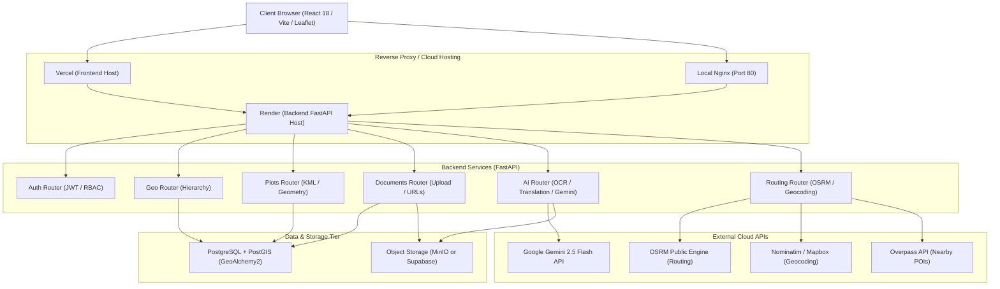
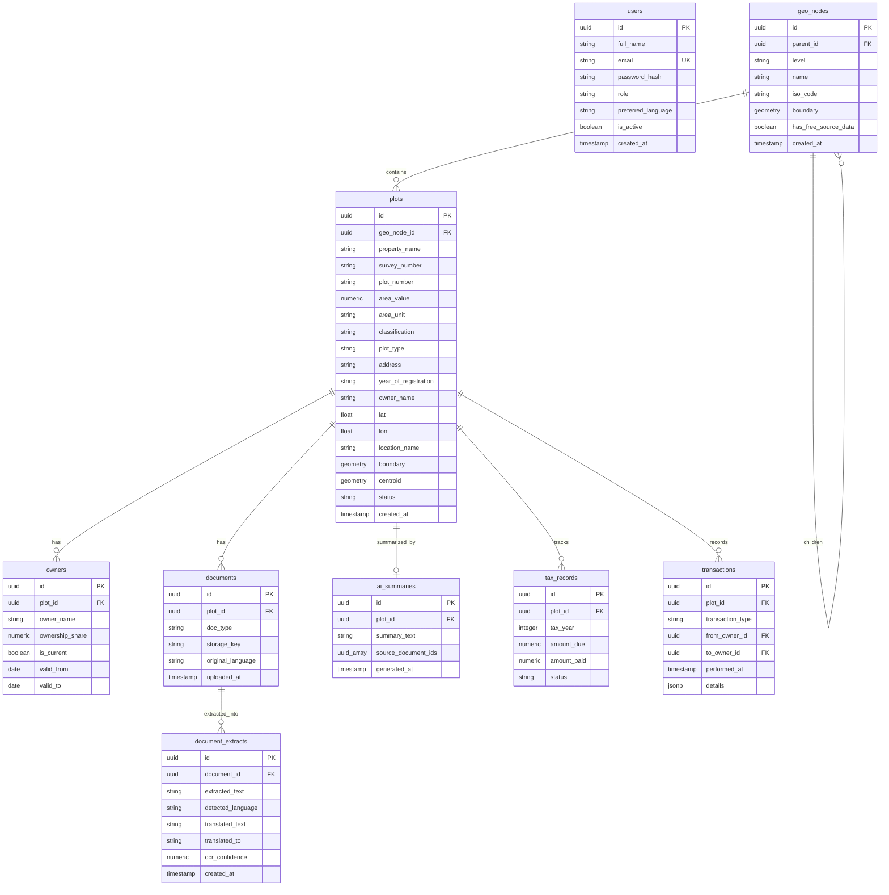

# Land Portfolio Management System (LPMS) — Codebase Documentation (`demo-branch`)

> **Comprehensive System Architecture, Directory Map, and File-by-File Reference**  
> *Branch*: `demo-branch`  
> *Repository*: `Anirudh2465/land-map`  

---

## 1. Executive Summary & Architecture Overview

The **Land Portfolio Management System (LPMS)** is an enterprise-grade GIS web application designed to manage, inspect, visualize, and analyze land parcels and associated legal records. Built with a dual-cloud/local deployment strategy, it enables users to seamlessly navigate geographic hierarchies, inspect high-resolution satellite imagery overlaid with cadastral boundaries, process legal deeds using AI/OCR, and calculate turn-by-turn routes to land properties.

### Key Capabilities
- **Geospatial Parcel Mapping**: Interactive Leaflet maps rendering high-accuracy PostGIS geometries, multi-layer base maps (OpenStreetMap, Esri World Imagery Satellite, CartoDB Positron), and custom marker overlays.
- **KML / KMZ Ingestion Engine**: Robust XML parser with automatic boundary fixing, coordinate reprojection, centroid calculation, and area computation in square meters and acres.
- **Hierarchical Geo-Navigation**: Granular drill-down navigation through geographic tiers (`Country` → `State` → `District` → `Taluk` → `Village` → `Plots`).
- **AI Document Intelligence**:
  - Optical Character Recognition (OCR) via PyTesseract and pdf2image.
  - Neural machine translation for regional land documents (Tamil to English) via Deep-Translator.
  - Automated legal risk analysis, deed summary, and encumbrance verification using Google Gemini Flash.
- **Turn-by-Turn Routing & Nearby Amenities**: OpenStreetMap OSRM driving/walking route calculations from any location to parcel coordinates, plus Overpass API nearby points-of-interest discovery (schools, hospitals, bus stations, transit).
- **Dual-Storage Abstraction**: Unified storage client supporting local offline MinIO S3 object storage or cloud-hosted Supabase Storage.
- **Dual Deployment Ready**: Seamless execution via local Docker Compose orchestration or cloud deployment (Render backend + Vercel frontend + Supabase Postgres/Storage).

---

## 2. Technology Stack Matrix

| Domain | Technology / Library | Purpose |
| :--- | :--- | :--- |
| **Backend Framework** | **FastAPI** (Python 3.11+) | Asynchronous REST API gateway, OpenAPI/Swagger docs, dependency injection. |
| **ASGI Server** | **Uvicorn** | High-performance production ASGI web server. |
| **Database & GIS** | **PostgreSQL 16** + **PostGIS 3.4** | Relational data persistence with geospatial geometry columns and spatial indexes. |
| **ORM & Migrations** | **SQLAlchemy 2.0** + **GeoAlchemy2** + **Alembic** | Object-relational mapping, spatial querying, and database schema migrations. |
| **Object Storage** | **MinIO** / **Supabase Storage** | S3-compatible document storage (PDF deeds, FMB sketches, KML files). |
| **Frontend Framework** | **React 18 / 19** + **Vite** | Modern, fast single-page client with modular component architecture. |
| **Frontend Router** | **React Router v6** | Client-side routing with route guards and dynamic URL parameters. |
| **Mapping Engine** | **Leaflet** + **React-Leaflet** | Interactive map viewport, polygon geometry rendering, custom icons, tile layers. |
| **AI / OCR Engine** | **PyTesseract**, **pdf2image**, **Google Gemini** | Document text extraction, Tamil-to-English translation, and legal deed summarization. |
| **Routing & Geocoding** | **OSRM**, **Mapbox Geocoding**, **Nominatim**, **Overpass** | Route planning, forward/reverse geocoding, and amenities search. |
| **Authentication** | **Passlib** (Bcrypt) + **Python-Jose** | JWT bearer token authorization with role-based access control (`ADMIN`, `EDITOR`, `VIEWER`). |
| **Containerization** | **Docker** & **Docker Compose** | Multi-container reproducible development and deployment environments. |

---

## 3. High-Level System Architecture



---

## 4. Complete Directory Map & File-by-File Breakdown

Below is the directory structure of the repository on branch `demo-branch`, followed by a file-by-file description.

```text
├── .env                              # Active runtime environment configuration
├── .env.cloud.example                # Template for cloud deployment (Supabase, Render)
├── .env.local.example                # Template for offline local Docker deployment
├── .gitattributes                    # Git line-ending and diff attributes
├── .gitignore                        # Global repository ignore rules
├── docker-compose.yml                # Docker orchestration for DB, MinIO, Backend, Frontend
├── phase_plan.md                     # Architectural phase roadmap and MVP specifications
├── progress.md                       # Historical development timeline and changelog
├── README.md                         # Project setup, container commands, and quick-start guide
├── start.bat / start.sh              # One-click startup scripts (Windows / Linux)
├── stop.bat / stop.sh                # Container teardown scripts
├── update.bat / update.sh            # Rebuild and container update scripts
│
├── backend/                          # FastAPI Python backend application
│   ├── alembic.ini                   # Alembic database migration configuration
│   ├── config.py                     # Pydantic BaseSettings loading .env configuration
│   ├── database.py                   # SQLAlchemy engine, session maker, and Base class
│   ├── Dockerfile                    # Multi-stage container build for FastAPI backend
│   ├── entrypoint.sh                 # Docker startup entrypoint (runs migrations & seeds)
│   ├── kml_parser.py                 # Resilient KML/KMZ spatial parser using Shapely
│   ├── main.py                       # FastAPI application factory, CORS, and router registration
│   ├── minio_client.py               # Dual-storage client (MinIO S3 or Supabase Storage)
│   ├── models.py                     # SQLAlchemy database models & GeoAlchemy2 geometries
│   ├── requirements.txt              # Python package dependencies
│   ├── seed.py                       # Initial database seeder (Admin user & Coimbatore hierarchy)
│   ├── ai/                           # AI & Document Processing Subsystem
│   │   ├── __init__.py               # Python package marker
│   │   ├── ocr_service.py            # PDF-to-image and Tesseract OCR extraction engine
│   │   ├── router.py                 # REST endpoints for OCR, translation, and AI summary
│   │   ├── summary_service.py        # Google Gemini 2.5 Flash legal summary generator
│   │   └── translation_service.py    # Deep-Translator Tamil-to-English translation service
│   ├── alembic/                      # Database migration scripts
│   │   ├── env.py                    # Alembic runtime environment script
│   │   ├── script.py.mako            # Migration template file
│   │   └── versions/                 # Versioned migration scripts
│   │       ├── 0001_initial_schema.py
│   │       ├── 2d123c762717_add_ai_models.py
│   │       ├── b4c9e712a801_change_plot_boundary_geometry_type.py
│   │       └── f932859fdb0b_add_new_plot_fields.py
│   ├── auth/                         # Authentication and RBAC Subsystem
│   │   ├── dependencies.py           # FastAPI dependency guards (`require_admin`, `require_editor`)
│   │   ├── router.py                 # Endpoints for `/api/auth/login`, `/me`, `/register`
│   │   ├── schemas.py                # Pydantic validation schemas for auth request/response
│   │   └── security.py               # Passlib password hashing and JWT token generator
│   ├── documents/                    # Document Management Subsystem
│   │   ├── __init__.py               # Python package marker
│   │   └── router.py                 # Endpoints for document upload, presigned URLs, deletion
│   ├── geo/                          # Geographic Hierarchy Subsystem
│   │   ├── __init__.py               # Python package marker
│   │   └── router.py                 # Endpoints for countries, child nodes, and node inspection
│   ├── plots/                        # Land Parcel GIS Subsystem
│   │   ├── __init__.py               # Python package marker
│   │   ├── router.py                 # CRUD endpoints for parcels, GeoJSON export, KML autofill
│   │   └── schemas.py                # Pydantic validation models for parcels, owners, transactions
│   └── routing/                      # Navigation and Places Subsystem
│       ├── __init__.py               # Python package marker
│       └── router.py                 # OSRM routing, geocoding, and Overpass nearby places
│
├── frontend/                         # React 18 / Vite single-page frontend application
│   ├── .oxlintrc.json                # Oxlint JavaScript linter configuration
│   ├── Dockerfile                    # Multi-stage production Nginx container build for frontend
│   ├── index.html                    # HTML5 entrypoint with Google Fonts and Leaflet stylesheets
│   ├── nginx.conf                    # Nginx reverse proxy configuration for frontend and API
│   ├── package.json                  # NPM dependencies and scripts (dev, build, lint)
│   ├── vercel.json                   # Vercel rewrite configuration for React Router SPA
│   ├── vite.config.js                # Vite build and development proxy configuration
│   ├── public/                       # Static public assets (icons, maps, Leaflet marker assets)
│   └── src/                          # Application source code
│       ├── App.css                   # Global styles and layout overrides
│       ├── App.jsx                   # Root component, React Router routing, and route protection
│       ├── index.css                 # Master design system (glassmorphism, variables, utilities)
│       ├── main.jsx                  # React DOM root initialization
│       ├── api/                      # Axios API clients
│       │   ├── ai.js                 # API bindings for OCR, translation, and AI summary
│       │   ├── auth.js               # API bindings for login, registration, and user session
│       │   ├── client.js             # Configured Axios instance with JWT Bearer token interceptor
│       │   ├── config.js             # Base URL resolver supporting local and cloud deployment
│       │   ├── documents.js          # API bindings for uploading and fetching documents
│       │   ├── geo.js                # API bindings for country and regional hierarchy
│       │   ├── plots.js              # API bindings for plot CRUD and KML autofill
│       │   └── routing.js            # API bindings for routes, geocoding, and nearby places
│       ├── assets/                   # Bundled UI assets
│       ├── components/               # Shared Reusable UI Components
│       │   ├── Header.jsx            # Sticky navigation bar with authentication status
│       │   └── ServerWarmupOverlay.jsx # Cold-start health check overlay for Render free-tier
│       ├── context/                  # React Context Providers
│       │   └── AuthContext.jsx       # Global authentication state, login/logout, and user roles
│       └── pages/                    # Application Views / Screens
│           ├── HomePage.jsx          # Landing page with hero banner and quick navigation cards
│           ├── LoginPage.jsx         # Sign-in form with error handling and credential presets
│           ├── ManagePage.jsx        # Land parcel registration and administrative dashboard
│           ├── MapPage.jsx           # Full-screen GIS map viewer with layers, routes, and drawer
│           └── NavigatorPage.jsx     # Geographic selector for drill-down navigation
│
└── data/                             # Parcel datasets, KML files, and legal documents
    ├── Full provided/                # Extensive archive of real Tamil Nadu revenue tax and sale deeds
    ├── provided/                     # Current working dataset for 11 Bogampatti parcels
    │   ├── seed_provided.py          # Batch ingestion script parsing KMLs and seeding DB
    │   └── Bogampatti/               # Survey parcel KMLs (SF_70 to SF_100), PDFs, and manifests
    ├── provided_backup/              # Historical backups of raw test datasets
    └── samples/                      # Mock parcels (Gandhipuram, Irugur, Podanur, Singanallur)
```

---

## 5. Granular File-by-File Breakdown

### 5.1 Root Workspace Files

- **[`.env`](file:///d:/Lab%20Project/Land%20Management%20System/code/.env)**: The active environment file containing PostgreSQL credentials, JWT secrets, MinIO / Supabase credentials, and the Gemini API key.
- **[`.env.local.example`](file:///d:/Lab%20Project/Land%20Management%20System/code/.env.local.example)**: Ready-to-use template for running 100% locally with Docker Compose (PostgreSQL on port 5432, MinIO on port 9000).
- **[`.env.cloud.example`](file:///d:/Lab%20Project/Land%20Management%20System/code/.env.cloud.example)**: Production template configured for Supabase PostgreSQL (pooler port 6543 / 5432) and Supabase Storage bucket.
- **[`docker-compose.yml`](file:///d:/Lab%20Project/Land%20Management%20System/code/docker-compose.yml)**: Defines 4 interconnected services:
  1. `db`: `postgis/postgis:16-3.4` database container with healthchecks.
  2. `minio`: `cgr.dev/chainguard/minio` S3-compatible storage container.
  3. `backend`: FastAPI Python application with live reload volume mount.
  4. `frontend`: Vite React build served via Nginx with API reverse proxying on port 80.
- **[`start.bat`](file:///d:/Lab%20Project/Land%20Management%20System/code/start.bat) / [`start.sh`](file:///d:/Lab%20Project/Land%20Management%20System/code/start.sh)**: Automates starting Docker containers, waiting for DB readiness, executing Alembic migrations, and executing seed scripts.
- **[`stop.bat`](file:///d:/Lab%20Project/Land%20Management%20System/code/stop.bat) / [`stop.sh`](file:///d:/Lab%20Project/Land%20Management%20System/code/stop.sh)**: Gracefully halts all running Docker containers.
- **[`update.bat`](file:///d:/Lab%20Project/Land%20Management%20System/code/update.bat) / [`update.sh`](file:///d:/Lab%20Project/Land%20Management%20System/code/update.sh)**: Rebuilds images when code dependencies change.
- **[`phase_plan.md`](file:///d:/Lab%20Project/Land%20Management%20System/code/phase_plan.md)**: Product roadmap tracking phases 0 through 9 (from initial setup to AI translation and overseas expansions).
- **[`progress.md`](file:///d:/Lab%20Project/Land%20Management%20System/code/progress.md)**: Engineering changelog documenting completed features, fixes, and testing milestones.
- **[`README.md`](file:///d:/Lab%20Project/Land%20Management%20System/code/README.md)**: Developer documentation providing setup instructions and test credentials.

---

### 5.2 Backend Core (`backend/`)

- **[`backend/main.py`](file:///d:/Lab%20Project/Land%20Management%20System/code/backend/main.py)**: The FastAPI entrypoint. Sets up CORS middleware supporting local development (`http://localhost:5173`) and cloud domains (`https://lms-fork.vercel.app`), registers custom exception handlers for database connection issues, and mounts all sub-routers under `/api`.
- **[`backend/config.py`](file:///d:/Lab%20Project/Land%20Management%20System/code/backend/config.py)**: Central configuration using `pydantic-settings`. Loads environment variables for `DATABASE_URL`, `SECRET_KEY`, `SUPABASE_*`, `MINIO_*`, `GEMINI_API_KEY`, and `MAPBOX_ACCESS_TOKEN`.
- **[`backend/database.py`](file:///d:/Lab%20Project/Land%20Management%20System/code/backend/database.py)**: Configures the SQLAlchemy database engine with connection pooling (`pool_pre_ping=True`, `pool_recycle=300`), defines `SessionLocal`, and provides the `get_db()` dependency for FastAPI routes.
- **[`backend/models.py`](file:///d:/Lab%20Project/Land%20Management%20System/code/backend/models.py)**: Defines all database tables:
  - `User`: Accounts, hashed passwords, roles (`ADMIN`, `EDITOR`, `VIEWER`).
  - `GeoNode`: Hierarchical tree nodes (`COUNTRY`, `STATE`, `DISTRICT`, `TALUK`, `VILLAGE`).
  - `Plot`: Land parcels with survey number, area, centroid `POINT`, and boundary `GEOMETRY`.
  - `Owner`: Ownership records with percentage shares and validity dates.
  - `Document`: Uploaded legal PDFs linked to plots with storage keys.
  - `DocumentExtract`: OCR-extracted text and translated English text.
  - `AISummary`: Gemini-generated legal summary and risk assessment for a plot.
  - `Transaction`: Historical ownership transfers and mutation events.
  - `TaxRecord`: Revenue tax payment records by Fasli/calendar year.
  - `AuditLog`: Action tracking for administrative compliance.
- **[`backend/minio_client.py`](file:///d:/Lab%20Project/Land%20Management%20System/code/backend/minio_client.py)**: Smart storage abstraction. Automatically inspects credentials: if `SUPABASE_URL` is set, it interfaces with Supabase Storage; otherwise, it connects to MinIO. Implements upload, download, presigned URL generation, and recursive object deletion.
- **[`backend/kml_parser.py`](file:///d:/Lab%20Project/Land%20Management%20System/code/backend/kml_parser.py)**: High-resilience KML/KMZ spatial parser. Unpacks zipped KMZ archives, handles XML namespaces, extracts Polygon and LinearRing coordinates, repairs invalid geometries via Shapely's `make_valid`, calculates metric polygon area (projected to UTM EPSG:32643), and computes the centroid.
- **[`backend/seed.py`](file:///d:/Lab%20Project/Land%20Management%20System/code/backend/seed.py)**: Database seeder that creates the default admin user (`admin@lms.com`) and establishes the root geography: India → Tamil Nadu → Coimbatore District.
- **[`backend/requirements.txt`](file:///d:/Lab%20Project/Land%20Management%20System/code/backend/requirements.txt)**: Specifies locked Python dependencies including FastAPI, SQLAlchemy 2, GeoAlchemy2, Shapely, PyTesseract, Google-GenAI, MinIO, and Supabase.
- **[`backend/Dockerfile`](file:///d:/Lab%20Project/Land%20Management%20System/code/backend/Dockerfile)**: Docker build definition including system binaries for Tesseract OCR, Poppler (for `pdf2image`), and GDAL/GEOS libraries.
- **[`backend/entrypoint.sh`](file:///d:/Lab%20Project/Land%20Management%20System/code/backend/entrypoint.sh)**: Container boot script that executes `alembic upgrade head`, runs `seed.py`, and launches Uvicorn.
- **[`backend/alembic.ini`](file:///d:/Lab%20Project/Land%20Management%20System/code/backend/alembic.ini)**: Alembic configuration pointing to database connection parameters.

---

### 5.3 Backend Modules & Routers

#### `backend/auth/`
- **[`backend/auth/security.py`](file:///d:/Lab%20Project/Land%20Management%20System/code/backend/auth/security.py)**: Implements Bcrypt password hashing (`verify_password`, `get_password_hash`) and JWT token creation (`create_access_token`).
- **[`backend/auth/schemas.py`](file:///d:/Lab%20Project/Land%20Management%20System/code/backend/auth/schemas.py)**: Pydantic models for user registration (`UserCreate`), login requests, and user profile response (`UserOut`).
- **[`backend/auth/dependencies.py`](file:///d:/Lab%20Project/Land%20Management%20System/code/backend/auth/dependencies.py)**: Dependency injection functions (`get_current_user`, `require_admin`, `require_editor`) verifying JWT Bearer tokens and enforcing role permissions.
- **[`backend/auth/router.py`](file:///d:/Lab%20Project/Land%20Management%20System/code/backend/auth/router.py)**: Auth endpoints:
  - `POST /api/auth/login`: Authenticates email/password and returns a JWT token.
  - `POST /api/auth/register`: Creates new user accounts (Admin-only).
  - `GET /api/auth/me`: Returns the authenticated user's profile and permissions.

#### `backend/geo/`
- **[`backend/geo/router.py`](file:///d:/Lab%20Project/Land%20Management%20System/code/backend/geo/router.py)**: Geographic tree endpoints:
  - `GET /api/geo/countries`: Lists all top-level countries.
  - `GET /api/geo/{node_id}/children`: Returns children for any node (states under a country, districts under a state, etc.).
  - `GET /api/geo/{node_id}`: Returns metadata for a single geographic entity.
  - `GET /api/geo/by-name/{level}/{name}`: Looks up a node by level and name.

#### `backend/plots/`
- **[`backend/plots/schemas.py`](file:///d:/Lab%20Project/Land%20Management%20System/code/backend/plots/schemas.py)**: Defines Pydantic validation schemas for plot creation (`PlotCreate`), updates, owner assignments, and GeoJSON feature representation.
- **[`backend/plots/router.py`](file:///d:/Lab%20Project/Land%20Management%20System/code/backend/plots/router.py)**: Core parcel operations:
  - `GET /api/plots`: Lists active parcels filtered by `geo_node_id`, status, or search query.
  - `POST /api/plots`: Registers a new parcel, accepts KML files, stores spatial geometries, and creates default owner entries.
  - `GET /api/plots/{id}`: Returns full details for a plot including documents, owners, and tax records.
  - `PUT /api/plots/{id}`: Updates plot metadata and ownership details.
  - `DELETE /api/plots/{id}`: Deletes a parcel, cascading to documents and MinIO/Supabase files.
  - `POST /api/plots/parse-kml`: Pre-submission endpoint that parses KML files on the fly and returns area, centroid, and geometry for frontend preview.
  - `GET /api/plots/geojson`: Exports parcels as standard RFC 7946 GeoJSON FeatureCollections for map rendering.

#### `backend/documents/`
- **[`backend/documents/router.py`](file:///d:/Lab%20Project/Land%20Management%20System/code/backend/documents/router.py)**: Document operations:
  - `POST /api/documents/upload`: Uploads deed, FMB sketch, or patta PDFs to storage and links them to a parcel ID.
  - `GET /api/documents/{id}/url`: Generates a secure, short-lived presigned download URL for viewing documents in the browser.
  - `DELETE /api/documents/{id}`: Deletes a document from both the database and object storage.

#### `backend/ai/`
- **[`backend/ai/ocr_service.py`](file:///d:/Lab%20Project/Land%20Management%20System/code/backend/ai/ocr_service.py)**: Converts uploaded PDF pages to high-DPI images using `pdf2image` and extracts text using Tesseract OCR with English and Tamil language packs (`eng+tam`).
- **[`backend/ai/translation_service.py`](file:///d:/Lab%20Project/Land%20Management%20System/code/backend/ai/translation_service.py)**: Translates non-English legal text into English using `deep-translator`.
- **[`backend/ai/summary_service.py`](file:///d:/Lab%20Project/Land%20Management%20System/code/backend/ai/summary_service.py)**: Analyzes extracted deed text using Google Gemini 2.5 Flash, generating a structured legal summary that highlights property identity, ownership lineage, encumbrances, and potential legal risks.
- **[`backend/ai/router.py`](file:///d:/Lab%20Project/Land%20Management%20System/code/backend/ai/router.py)**: Exposes endpoints:
  - `POST /api/ai/ocr/{doc_id}`: Triggers OCR extraction on a document.
  - `POST /api/ai/translate/{doc_id}`: Translates extracted text.
  - `POST /api/ai/summarize/{plot_id}`: Generates or refreshes the Gemini AI legal summary for a parcel.
  - `GET /api/ai/summary/{plot_id}`: Retrieves cached AI summaries.

#### `backend/routing/`
- **[`backend/routing/router.py`](file:///d:/Lab%20Project/Land%20Management%20System/code/backend/routing/router.py)**: Real-time navigation and geographic intelligence:
  - `GET /api/routing/route`: Calculates driving and walking routes via the OSRM routing engine, returning turn-by-turn geometry, distance, and duration.
  - `GET /api/routing/geocode`: Converts textual addresses into geographic coordinates using Mapbox API with Nominatim fallback.
  - `GET /api/routing/reverse-geocode`: Converts latitude/longitude coordinates into human-readable street addresses.
  - `GET /api/routing/places-nearby`: Queries OpenStreetMap Overpass API for amenities within a radius (schools, transit, hospitals, fuel stations).

---

### 5.4 Frontend Application (`frontend/`)

- **[`frontend/index.html`](file:///d:/Lab%20Project/Land%20Management%20System/code/frontend/index.html)**: HTML entry point. Loads the Inter Google Font, Leaflet CSS (`leaflet@1.9.4`), and sets the application title.
- **[`frontend/vite.config.js`](file:///d:/Lab%20Project/Land%20Management%20System/code/frontend/vite.config.js)**: Configures Vite development server, port `5173`, and reverse-proxy rules redirecting `/api` requests to the FastAPI backend.
- **[`frontend/vercel.json`](file:///d:/Lab%20Project/Land%20Management%20System/code/frontend/vercel.json)**: Vercel SPA routing configuration redirecting all client paths to `/index.html`.
- **[`frontend/nginx.conf`](file:///d:/Lab%20Project/Land%20Management%20System/code/frontend/nginx.conf)**: Production Nginx server configuration for Docker deployment with gzip compression and API reverse proxying.
- **[`frontend/package.json`](file:///d:/Lab%20Project/Land%20Management%20System/code/frontend/package.json)**: Defines dependencies including `react`, `react-router-dom`, `leaflet`, `react-leaflet`, and `axios`.
- **[`frontend/src/index.css`](file:///d:/Lab%20Project/Land%20Management%20System/code/frontend/src/index.css)**: Master design system implementing dark/light mode CSS custom properties, glassmorphism card styling, responsive layout utilities, and buttons.
- **[`frontend/src/App.css`](file:///d:/Lab%20Project/Land%20Management%20System/code/frontend/src/App.css)**: Page-level styling overrides for navigation cards and map controls.
- **[`frontend/src/App.jsx`](file:///d:/Lab%20Project/Land%20Management%20System/code/frontend/src/App.jsx)**: Root component setting up the React Router structure, the `ServerWarmupOverlay`, and route guards for protected admin routes.
- **[`frontend/src/main.jsx`](file:///d:/Lab%20Project/Land%20Management%20System/code/frontend/src/main.jsx)**: Entrypoint rendering `<App />` into the DOM.

#### `frontend/src/api/`
- **[`frontend/src/api/config.js`](file:///d:/Lab%20Project/Land%20Management%20System/code/frontend/src/api/config.js)**: Resolves the API base URL. Uses `VITE_API_URL` when provided (e.g., Render URL) or falls back to `/api` for local reverse proxying.
- **[`frontend/src/api/client.js`](file:///d:/Lab%20Project/Land%20Management%20System/code/frontend/src/api/client.js)**: Axios instance with request interceptors attaching `Authorization: Bearer <token>` from local storage.
- **[`frontend/src/api/auth.js`](file:///d:/Lab%20Project/Land%20Management%20System/code/frontend/src/api/auth.js)**: Methods for `loginUser(email, password)` and `getMe()`.
- **[`frontend/src/api/geo.js`](file:///d:/Lab%20Project/Land%20Management%20System/code/frontend/src/api/geo.js)**: Methods for `getCountries()`, `getChildren(nodeId)`, and `getNode(nodeId)`.
- **[`frontend/src/api/plots.js`](file:///d:/Lab%20Project/Land%20Management%20System/code/frontend/src/api/plots.js)**: Methods for `getPlots(geoNodeId)`, `getPlot(plotId)`, `createPlot(formData)`, `updatePlot(id, data)`, `deletePlot(id)`, and `autofillFromKml(file)`.
- **[`frontend/src/api/documents.js`](file:///d:/Lab%20Project/Land%20Management%20System/code/frontend/src/api/documents.js)**: Methods for `uploadDocument(plotId, file, docType)`, `getDownloadUrl(docId)`, and `deleteDocument(docId)`.
- **[`frontend/src/api/ai.js`](file:///d:/Lab%20Project/Land%20Management%20System/code/frontend/src/api/ai.js)**: Methods for `triggerOcr(docId)`, `translateDocument(docId, lang)`, `generateSummary(plotId)`, and `getSummary(plotId)`.
- **[`frontend/src/api/routing.js`](file:///d:/Lab%20Project/Land%20Management%20System/code/frontend/src/api/routing.js)**: Methods for `getRoute(start, end)`, `geocode(address)`, `reverseGeocode(lat, lng)`, and `getNearbyPlaces(lat, lng)`.

#### `frontend/src/components/`
- **[`frontend/src/components/Header.jsx`](file:///d:/Lab%20Project/Land%20Management%20System/code/frontend/src/components/Header.jsx)**: Sticky responsive navigation header displaying the LPMS brand logo, navigation links ("View Land Parcels", "Update Records"), user avatar, role badge (`Admin`, `Editor`), and logout button.
- **[`frontend/src/components/ServerWarmupOverlay.jsx`](file:///d:/Lab%20Project/Land%20Management%20System/code/frontend/src/components/ServerWarmupOverlay.jsx)**: UX enhancement for cloud hosting. Periodically pings `/api` on application load. If the server is on a cold start (e.g. Render free tier spinning up), it displays a friendly progress overlay instead of throwing errors.

#### `frontend/src/context/`
- **[`frontend/src/context/AuthContext.jsx`](file:///d:/Lab%20Project/Land%20Management%20System/code/frontend/src/context/AuthContext.jsx)**: Context provider managing user authentication state, token persistence in `localStorage`, session validation on load, and role-checking helpers (`isAdmin`, `isEditor`).

#### `frontend/src/pages/`
- **[`frontend/src/pages/HomePage.jsx`](file:///d:/Lab%20Project/Land%20Management%20System/code/frontend/src/pages/HomePage.jsx)**: Modern homepage with a hero background, system value propositions, and direct entry points to `/navigate/view` and `/navigate/manage`.
- **[`frontend/src/pages/LoginPage.jsx`](file:///d:/Lab%20Project/Land%20Management%20System/code/frontend/src/pages/LoginPage.jsx)**: Secure login interface with password masking and pre-filled quick-fill test credentials.
- **[`frontend/src/pages/NavigatorPage.jsx`](file:///d:/Lab%20Project/Land%20Management%20System/code/frontend/src/pages/NavigatorPage.jsx)**: Geographic drill-down component. Manages selection from Country to State to District, dynamically loading sub-regions and routing users to either the map viewer (`/map/:districtId`) or parcel administration (`/manage/:districtId`).
- **[`frontend/src/pages/MapPage.jsx`](file:///d:/Lab%20Project/Land%20Management%20System/code/frontend/src/pages/MapPage.jsx)**: The central GIS interface:
  - Interactive Leaflet map with tile switching (Satellite Imagery vs Standard OSM).
  - GeoJSON polygon rendering of parcels with hover highlights and popups.
  - Floating slide-over card displaying parcel area, classification, survey number, and owner details.
  - Turn-by-turn navigation overlay rendering driving routes with distance and arrival time estimates.
  - Document viewer drawer with PDF download links.
  - AI Legal Summary modal presenting deed analysis and risk ratings.
- **[`frontend/src/pages/ManagePage.jsx`](file:///d:/Lab%20Project/Land%20Management%20System/code/frontend/src/pages/ManagePage.jsx)**: Comprehensive administrative portal:
  - Lists all registered parcels within the selected district.
  - Add Parcel form supporting KML upload with one-click "Autofill Details from KML".
  - Multi-file PDF uploader for Sale Deeds, Patta/Chitta, and FMB sketches.
  - Inline deletion and editing capabilities.

---

### 5.5 Data and Datasets (`data/`)

- **[`data/provided/seed_provided.py`](file:///d:/Lab%20Project/Land%20Management%20System/code/data/provided/seed_provided.py)**: Python automation script that reads KML boundary files and PDFs for 11 official Bogampatti parcels (SF_70, SF_75, SF_76, SF_77, SF_78, SF_79, SF_80, SF_81, SF_82, SF_100), registers them into the database under Coimbatore, and uploads associated documents to MinIO / Supabase Storage.
- **[`data/provided/Bogampatti/`](file:///d:/Lab%20Project/Land%20Management%20System/code/data/provided/Bogampatti)**: Production dataset containing survey boundary KML files, registered deed PDFs, and manifest metadata files for each survey field.
- **[`data/Full provided/`](file:///d:/Lab%20Project/Land%20Management%20System/code/data/Full%20provided)**: Archive of official Tamil Nadu land administration documents:
  - `Land documents/`: Historical registered sale deeds dating from 1969 to 1995.
  - `Land Revenue Tax/`: Annual tax receipts covering Fasli years 1429 through 1434 (2019-2024).
  - `Patta/`: Official government Patta records and Field Measurement Book (FMB) sketches.
- **[`data/samples/`](file:///d:/Lab%20Project/Land%20Management%20System/code/data/samples)**: Test KML files representing parcels across Coimbatore (Gandhipuram, Irugur, Podanur, Singanallur) and sample legal PDFs used for local offline testing.

---

## 6. Database Entity-Relationship Schema



---

## 7. Complete API Endpoint Catalog

| Module | Method | Endpoint | Access Level | Description |
| :--- | :--- | :--- | :--- | :--- |
| **Auth** | `POST` | `/api/auth/login` | Public | Authenticates credentials and returns JWT Bearer token. |
| **Auth** | `POST` | `/api/auth/register` | Admin Only | Registers a new user account with specified role. |
| **Auth** | `GET` | `/api/auth/me` | Authenticated | Returns current authenticated user details and role. |
| **Geo** | `GET` | `/api/geo/countries` | Public | Returns list of top-level country nodes. |
| **Geo** | `GET` | `/api/geo/{id}/children`| Public | Returns child regions under a parent node. |
| **Geo** | `GET` | `/api/geo/{id}` | Public | Fetches detailed metadata for a specific geographic node. |
| **Plots** | `GET` | `/api/plots` | Public | Lists active plots, filterable by `geo_node_id` or query. |
| **Plots** | `POST` | `/api/plots` | Editor / Admin | Creates a new parcel with boundary geometry and metadata. |
| **Plots** | `GET` | `/api/plots/{id}` | Public | Retrieves parcel details, owners, documents, and tax status. |
| **Plots** | `PUT` | `/api/plots/{id}` | Editor / Admin | Updates parcel attributes and metadata. |
| **Plots** | `DELETE`| `/api/plots/{id}` | Admin Only | Cascades deletion of parcel, records, and stored files. |
| **Plots** | `POST` | `/api/plots/parse-kml` | Editor / Admin | Parses uploaded KML on the fly for form autofill. |
| **Plots** | `GET` | `/api/plots/geojson` | Public | Streams GeoJSON FeatureCollection of all parcels. |
| **Docs** | `POST` | `/api/documents/upload`| Editor / Admin | Uploads a PDF to storage and links to a plot ID. |
| **Docs** | `GET` | `/api/documents/{id}/url`| Public | Generates a presigned temporary URL for PDF viewing. |
| **Docs** | `DELETE`| `/api/documents/{id}` | Admin Only | Deletes a document from database and object storage. |
| **AI** | `POST` | `/api/ai/ocr/{doc_id}` | Authenticated | Executes Tesseract OCR on a document. |
| **AI** | `POST` | `/api/ai/translate/{doc_id}`| Authenticated | Translates extracted OCR text to target language. |
| **AI** | `POST` | `/api/ai/summarize/{plot_id}`| Authenticated | Generates Google Gemini legal summary for a parcel. |
| **AI** | `GET` | `/api/ai/summary/{plot_id}` | Public | Fetches cached Gemini AI summary for a parcel. |
| **Routing**| `GET` | `/api/routing/route` | Public | Computes turn-by-turn driving route between coordinates. |
| **Routing**| `GET` | `/api/routing/geocode` | Public | Geocodes an address to latitude and longitude. |
| **Routing**| `GET` | `/api/routing/reverse-geocode`| Public | Reverse geocodes coordinates to street address. |
| **Routing**| `GET` | `/api/routing/places-nearby`| Public | Finds nearby amenities (schools, transit, hospitals). |

---

## 8. Deployment and Runtime Guide

### 8.1 Local Docker Deployment
1. Ensure Docker Desktop is running on Windows.
2. Initialize environment:
   ```powershell
   copy .env.local.example .env
   ```
3. Launch stack:
   ```powershell
   .\start.bat
   # or: docker compose up -d --build
   ```
4. Access endpoints:
   - **Frontend**: [http://localhost:5173](http://localhost:5173) or [http://localhost:80](http://localhost:80)
   - **Backend API Docs**: [http://localhost:8000/docs](http://localhost:8000/docs)
   - **MinIO Storage Console**: [http://localhost:9001](http://localhost:9001)

### 8.2 Cloud Deployment (Vercel + Render + Supabase)
1. **Database & Storage**: Provision a Supabase PostgreSQL instance with PostGIS and create a public or authenticated `geospatial` storage bucket.
2. **Backend (Render)**:
   - Connect GitHub repository tracking `demo-branch`.
   - Set Root Directory to `backend`.
   - Set Build Command: `pip install -r requirements.txt`.
   - Set Start Command: `uvicorn main:app --host 0.0.0.0 --port $PORT`.
   - Supply environment variables from `.env.cloud.example`.
3. **Frontend (Vercel)**:
   - Connect GitHub repository tracking `demo-branch`.
   - Set Root Directory to `frontend`.
   - Configure Environment Variable: `VITE_API_URL=https://<your-render-app>.onrender.com`.
   - Deploy.
